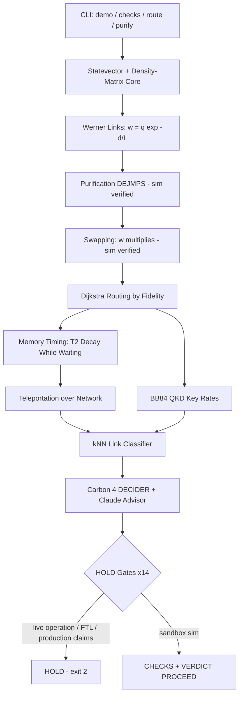
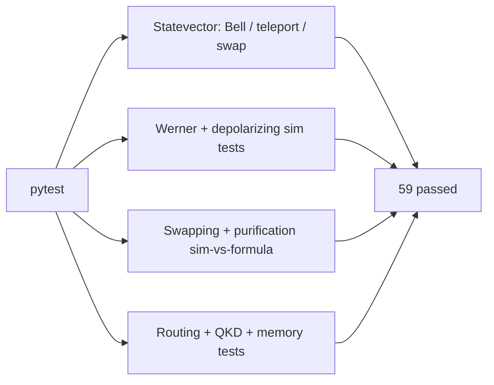
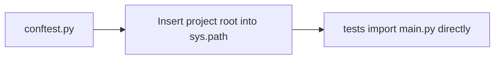
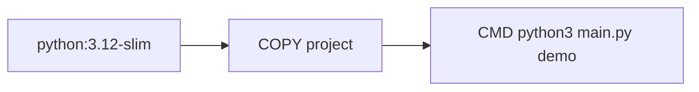

# EntangleNet-Q 🌐⚛️

**Quantum Internet Repeater Network Lab** — by Darion Kellar

## ❓ What is this?

EntangleNet-Q is an **educational quantum internet / repeater network lab** in ONE pure-Python file. It is the **network layer** that sits on top of Darion's TeleportX (the teleportation protocol) and Q6G-1TB (the link + BB84 model): how **Bell pairs** are born on noisy links, **purified** until they are worth spending, **swapped** through repeater chains, **routed** across a small city graph by end-to-end fidelity, forced to **wait in quantum memories** (and decay while they wait), and finally spent on **teleportation** and **BB84 QKD** — with every formula **checked against a from-scratch statevector / density-matrix simulator**, not just asserted. 🔬

Honest scope, stated up front: a production quantum internet **does not exist yet**. This lab models the published physics (Werner states, Bennett/DEJMPS purification, entanglement swapping, Shor–Preskill key rates) and operates **nothing**: no network, no hardware, no satellite, no real keys — and nothing here moves information faster than light. Every live-operation / production claim sits behind a permanent HOLD gate (14 total). 🔒

## 🧰 Tech Stack Badges & Full Architecture


> ℹ️ Workflow badges are static **'Pending Paste'** shields on purpose: the `ci.yml` and `docker-publish.yml` files are delivered in the local paste pack and are **not pasted yet**, so no live badge is claimed.

**📦 1. Language & Runtime**
- 🐍 Python 3.12, pure standard library (`math`, `heapq`, `hashlib`, `json`, `sys`)
- 🚫 Zero dependencies, zero network, deterministic (double-run byte-identical)

**⚛️ 2. Quantum Core**
- 🌀 Statevector simulator (≤ 6 qubits, circuit-built Bell pairs, ideal teleportation + swapping)
- 🧮 Density-matrix toolkit (≤ 4-qubit systems): Werner states, depolarizing channels, Bell projection, partial trace
- 🔗 Swapping product rule, DEJMPS purification, BB84/Shor–Preskill rates, memory T2 decay — **all verified sim-vs-formula**

**🤖 3. AI / ML**
- 🧠 TinyML kNN link-regime classifier (from scratch, stdlib): good / marginal / unusable
- 🔮 Gemini Carbon 4 DECIDER seat (names-only, tighten-only) + Muse advisor (never overrides HOLD)

**🎬 4. Media / Planning**
- 🎥 Google Flow plan-only seat (rendered = False, live = 0)

**🐳 5. Infrastructure**
- 🐳 Docker (`python:3.12-slim`), GitHub Actions CI + Docker Publish (paste pack)
- 🎯 Target image: `credkellar/entanglenet-q:latest`

**🔒 6. Safety**
- ⛔ 14 HOLD gates — live network operation, real hardware, FTL claims, production claims, live QKD keys, and more are permanently held

## 🔬 What this does

1. 🔗 **Bell pairs on noisy links** — every link delivers a **Werner state** with weight `w = q · exp(-d / L)` (fiber quality × distance decay) and fidelity `F = (1 + 3w)/4`. A depolarizing-channel formula is checked against a Pauli-twirl density-matrix simulation.
2. 🔀 **Entanglement swapping** — two pairs in, one end-to-end pair out. The Werner weights **multiply** (`w_end = w1 · w2`), and a full 4-qubit density-matrix Bell-projection simulation reproduces the product rule to 1e-9.
3. ✨ **Purification (DEJMPS-style)** — two noisy pairs become one better pair, with the standard fidelity map and success probability — **simulated** with bilateral CNOTs and coincidence measurement. The lab proves the famous threshold in code: `F > 0.5` climbs toward 1, `F = 0.5` is a fixed point, `F < 0.5` gets *worse*.
4. 🗺️ **Repeater routing** — a labeled sim graph (Los Angeles / Las Vegas / Phoenix / Albuquerque / Denver / Dallas) routed by **Dijkstra on −ln w**: the best-fidelity route from Los Angeles to Phoenix goes **via Las Vegas**, because the direct edge is labeled legacy noisy fiber. Fidelity beats hop count.
5. 🌀 **Teleportation over the network** — the end-to-end pair is spent on the TeleportX protocol: output fidelity `(2F + 1)/3`, verified against a 3-qubit density-matrix circuit simulation. Raw LA→Dallas chain: pair F = 0.5022 → teleport F = 0.6681 (a coin-flip above the 2/3 classical limit); with each link purified twice first: pair F = 0.6002 → teleport F = **0.7335**.
6. 🔑 **QKD over links** — the Q6G-1TB BB84 model, network edition: QBER from the link weight, Shor–Preskill secret fraction `1 − 2·h2(Q)`, and an effective pair-rate model give key-rate-vs-distance estimates — labeled model numbers, never guarantees.
7. ⏳ **Quantum memory timing** — the repeater timing problem: links succeed at different expected times, early pairs **wait and decay** as `w · exp(-t / T2)`. On the LA→Dallas route the wait costs real fidelity: F = 0.5022 fresh → **0.3463** after expected waits (T2 = 1 s sim parameter).
8. 🏷️ **Link regime classifier** — a from-scratch kNN labels links `good` / `marginal` / `unusable` from distance + noise features.
9. 🧠 **Advisory seats + checks** — Carbon 4 DECIDER with sha256 trace, Muse advisor, Google Flow plan-only, and a built-in CHECKS suite (45 checks).

## 🗺️ How it works — diagram per script

### `main.py` — the whole lab



### `tests/test_main.py` — verification



### `conftest.py` — test path setup



### `Dockerfile` — container



## 🤩 Why is this cool?

1. 🌐 It is the **network layer** of Darion's quantum stack — TeleportX was one hop, Q6G-1TB was one link; this is the whole map.
2. 🔀 The swapping product rule is not asserted — a 16×16 density-matrix simulation **reproduces it exactly**.
3. ✨ Purification's 0.5 threshold is proven three ways: formula, simulation, and iteration (0.75 → 0.9446 in 6 rounds; 0.40 → 0.3846, worse).
4. 🗺️ Routing by fidelity instead of hops produces a genuinely surprising answer — Phoenix via Las Vegas — for a stated physical reason.
5. 🌀 Teleportation over a 3-hop chain lands at F = 0.6681 raw — *just* above the classical limit — and purification is what makes the win real (0.7335).
6. ⏳ The memory-timing section shows the hidden tax nobody puts in headlines: waiting for the chain costs 0.5022 → 0.3463.
7. 🔑 QKD key rates fall out of the *same* link model as everything else — one physics, five applications.
8. 🧮 The whole thing — statevectors, density matrices, Dijkstra, kNN, binary entropy — is stdlib `math` and lists. No numpy. Anywhere.
9. 🔒 14 HOLD gates draw the anti-hype line in code: FTL, production quantum internet, and live key use all exit 2.
10. 🎯 Deterministic end to end: run it twice, get byte-identical output — a network you can diff.

## 🛠️ What problems this solves?

1. ❌ **Problem:** "Quantum internet" headlines imply a working network you can almost buy. ✅ **Solution:** The lab states up front that none exists, gates the claim, and simulates the physics instead.
2. ❌ **Problem:** Entanglement swapping is usually described with hand-waving. ✅ **Solution:** It is computed two independent ways (product rule + density-matrix projection) and they must agree to 1e-9.
3. ❌ **Problem:** Purification sounds like a free fidelity upgrade. ✅ **Solution:** The success probability is printed with every round, and below F = 0.5 the lab shows it *hurting*.
4. ❌ **Problem:** Network demos route by hop count because it is easy. ✅ **Solution:** Dijkstra runs on −ln w, so route choice is driven by end-to-end fidelity — and the fewest-hops route is shown losing.
5. ❌ **Problem:** Teleportation demos use perfect Bell pairs. ✅ **Solution:** The resource here is a routed, purified, memory-decayed Werner pair — the output fidelity is the honest (2F + 1)/3.
6. ❌ **Problem:** QKD rates get quoted without a link model. ✅ **Solution:** QBER, secret fraction, and pair rate all derive from the same Werner link, with assumptions printed.
7. ❌ **Problem:** Quantum memory decoherence is ignored in popular repeater explainers. ✅ **Solution:** Expected waits are scheduled per link and the fidelity cost is computed, not mentioned.
8. ❌ **Problem:** Entanglement gets marketed as faster-than-light messaging. ✅ **Solution:** `claim_ftl_communication` is a permanent HOLD gate, and teleportation here visibly needs its classical correction step.
9. ❌ **Problem:** Quantum code usually needs a heavy stack (numpy / qiskit) to run at all. ✅ **Solution:** Pure standard library — statevectors and density matrices built from Python complex numbers.
10. ❌ **Problem:** Simulation tools quietly imply deployment is next. ✅ **Solution:** 14 named HOLD gates return exit code 2 for every live-operation claim, forever.

## 📥 How to install step-by-step

1. 📋 Clone or download this project folder.
2. 🐍 Make sure Python 3.12+ is installed: `python3 --version`
3. ▶️ Run the full demo + checks (no arguments needed):

```bash
python3 main.py
```

4. 🧪 Run the test suite:

```bash
pip install pytest
python3 -m pytest -q
```

5. 🎛️ Try the other commands:

```bash
python3 main.py checks       # 45 built-in checks
python3 main.py route        # best-fidelity vs fewest-hops, LA -> Dallas
python3 main.py swap         # swapping: formula vs simulation
python3 main.py purify       # DEJMPS fidelity map + success probabilities
python3 main.py teleport-net # raw vs purified chain teleportation
python3 main.py qkd          # BB84 key-rate table vs distance
python3 main.py memory       # repeater timing: waits decay the chain
python3 main.py classify     # kNN link regime report
python3 main.py brains       # Carbon 4 + Muse + Flow seats
python3 main.py holds        # list all 14 HOLD gates
python3 main.py hold-demo    # exits 2 - gated claims stay HOLD
```

6. 🐳 Or run it in Docker:

```bash
docker build -t credkellar/entanglenet-q:latest .
docker run --rm credkellar/entanglenet-q:latest
```

## 📋 Requirements

- 🐍 Python 3.12 or newer
- 📦 Dependencies: **none** (standard library only)
- 🌐 Network: **none** — fully offline
- 🧪 For tests only: `pytest`
- 🐳 Optional: Docker

## 🧒 5th-grade English section

Imagine you and a friend each hold one half of a **magic coin pair**. 🪙

- When you both flip your coins, they always match — even if you are in different cities. Scientists call this **entanglement**. This project builds those coin pairs on a pretend map. 🗺️
- The pairs get **dirty** on long trips, like a white shirt in the rain. **Purification** is a washing trick: use two dirty pairs, keep one cleaner pair — but the trick only works if the pairs are not *too* dirty, and sometimes the wash fails and you throw both away. 🧺
- Cities in the middle can **swap**: they join their coin pairs so two far-apart cities end up sharing a pair, even though they never met. That is how a **quantum repeater** works. 🔀
- Choosing the best road matters: the shortest road is sometimes the dirtiest, so this project picks the road that keeps the pairs **cleanest**, not the one with fewest stops. 🛣️
- While pairs wait for their friends to be ready, they **fade**, like glow-in-the-dark stars losing their shine. Waiting costs real magic, and the project counts the cost. ⏳
- At the end, a pair can **teleport** a tiny message-state across the map — but a normal phone call still has to happen too, so nothing travels faster than light. 📞
- This is a **pretend lab on a computer**. A real quantum internet does not exist yet — this project practices the math honestly until it does. 💻

## 🌳 Full file tree

```text
entanglenet-q/
├── main.py                  # the whole lab: simulators, Werner links, swapping, purification, routing, teleport, QKD, memory, seats, HOLD gates
├── conftest.py              # puts the project root on sys.path for tests
├── tests/
│   └── test_main.py         # 59 pytest tests: simulators, sim-vs-formula, routing, QKD, gates, determinism
├── assets/
│   └── cover.png            # README cover image (2736 x 912)
├── Dockerfile               # python:3.12-slim, runs the demo
└── README.md                # this file
```

> 📦 Delivered separately as paste packs (not in this tree): `.github/workflows/ci.yml` + `docker-publish.yml`, and the Docker Hub pack (100-char description, 350-char About, overview, categories).

---

MIT © 2026 Darion Kellar · EntangleNet-Q — educational simulation only 🌐
